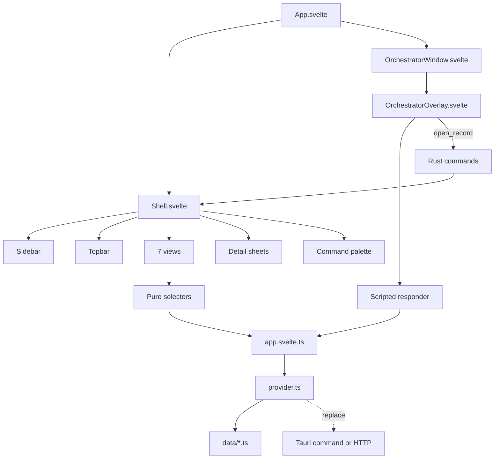
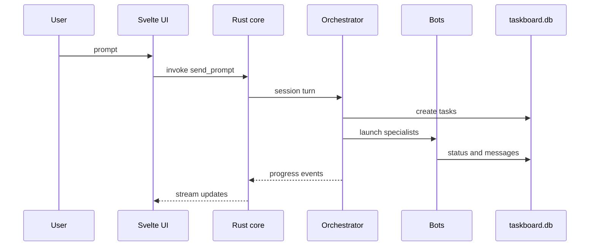

# Architecture

The desktop app is a thin, deterministic renderer over a workforce snapshot. It owns presentation, filtering, and local interaction state. It does not own orchestration, model calls, or persistence yet.

## Runtime

- Tauri 2 shell with two windows. Main window 1360x820 with a 1080x720 floor. Orchestrator overlay 720x420, frameless, always on top, hidden until `Alt+\`` or the topbar button.
- Svelte 5 renderer with runes, TypeScript strict, Vite 8, Tailwind CSS 4.
- One Tauri plugin: global-shortcut, registered in Rust. Capabilities stay at `core:default`; window show, hide, record navigation, and policy reading go through four app commands.
- CSP allows local assets, inline styles (dynamic bar widths), and Tauri IPC only.
- Rust exposes `open_orchestrator`, `hide_orchestrator`, `open_record`, and `read_policy`; everything else lives in the renderer.

## Layers



Views receive a `Snapshot` prop from `Shell`. They never import fixtures directly, with one exception: the scripted orchestrator responder reads the live snapshot inside the overlay webview.

## Policy and prompts

`src-tauri/src/lib.rs` exposes `read_policy(project_root)`. It reads the global file at `%USERPROFILE%\.config\opencode\AGENTS.md`, or `AGENT_BOTS_GLOBAL_POLICY` when set, plus the selected project's `AGENTS.md`. It returns content, path, byte count, a stable FNV-1a hash, and any read error. The renderer never reads arbitrary files.

`src/lib/prompts.ts` parses prompt frontmatter and assembles layers in order:

```text
global policy
project policy
agent role
task context
retrieved memory
shared contract
```

`src/lib/prompt-files.ts` bundles `prompts/agents/*.md`, `prompts/shared/handoff.md`, and `prompts/shared/memory-proposal.md` at build time. Agent detail shows the assembled result. Settings shows the global and project policy path, hash, size, load time, and a reload control. In browser-only development the policy reader reports that files are available only in the desktop app.

The runtime does not yet enforce policy availability, but the interface exposes the state and tests assert layer order.

## OpenCode runtime

The app treats OpenCode as the execution harness. It does not implement its own model/tool loop or MCP client.

- `src-tauri/src/opencode.rs` starts a local `opencode serve` child on a free loopback port in the range 4097 to 4197, with a generated server password. If `OPENCODE_SERVER_PASSWORD` is set, the app attaches to a matching service instead.
- The child is killed with its process tree on stop or app exit.
- The adapter wraps health, agents, models, sessions, prompt, abort, messages, permission requests, permission replies, and MCP status.
- The renderer never receives the server password and never starts the process.
- The runtime panel in Settings can connect, list built-in agents and tool-capable models, start a real session, display messages and tool calls, reply to permission requests, and abort.

Current limitations:

- Message and permission updates are polled, not streamed from the OpenCode event bus.
- Sessions are not linked to app tasks yet.
- Custom project agents are not synced into `.opencode/agents` yet, so the panel currently shows built-in OpenCode agents.
- Runtime state is not persisted after app restart.

## Provider seam

`src/lib/data/provider.ts` exports one function:

```ts
loadSnapshot(): Promise<Snapshot>
```

The mock implementation returns a structured clone of `src/lib/data/index.ts`. Swapping in a backend means changing that body, for example:

```ts
return invoke<Snapshot>("load_snapshot");
```

No view, selector, or store changes. The contract is `src/lib/types.ts`.

## State

`src/lib/state/app.svelte.ts` is the store for each window:

- current view, open sheet, palette
- loaded snapshot and ready flag
- policy bundle, policy project, loading and error state
- overlay fallback flag
- conversation transcript and pending reply flag (overlay webview only)

Selection is a discriminated reference (`agent | project | task | memory`), so only one detail sheet is open at a time. Cross-view jumps (`openTask`) set the view and sheet in one action.

Each webview has its own store instance. The overlay keeps its own transcript while hidden; the main window never shows chat. There is no persistence, so quitting the app resets both.

## Navigation

Seven views: Overview, Agents, Projects, Tasks, Activity, Memory, Settings. Details open as right-side sheets over the current view. `Ctrl+K` opens a palette that searches views, agents, projects, and tasks.

The orchestrator is a separate 720x420 frameless window, summoned with `Alt+\`` or the topbar button. It stays hidden between uses. The webview stays alive, so the transcript survives close and reopen for the session. Inside the overlay, the last exchange is shown by default; `Full thread` reveals the rest. Reference chips call the `open_record` command, which hides the overlay and opens the record in the main window.

The main window has no chat dock. Its content uses the full width behind the 220 px sidebar.

## Orchestrator simulation

`src/lib/orchestrator.ts` matches a prompt against keyword groups and builds a reply from the current snapshot: running work, blockers, Vault beta path, Dreamer memory, or the agent roster. The overlay waits 650 ms, then appends the reply and reference chips. Its visual language follows the LearnGraph daily tracker: black surface, 1 px border, square corners, monochrome text, green only for the simulated marker.

To connect a real orchestrator later:

1. Add a Tauri command or HTTP endpoint that accepts a prompt and returns a structured reply.
2. Replace the `setTimeout` branch in `OrchestratorOverlay.svelte` with that call.
3. Keep the simulation label until the endpoint is real, then replace it with connection state.

## Future integration path



The existing task board uses `todo | running | done | blocked`. The app currently uses `queued | running | review | blocked | done`. A backend adapter must map states explicitly; see [[Bot-Workspace]].

## Security posture

- One local window pair, no remote URLs loaded.
- No shell, filesystem, HTTP, or updater plugin installed. Global shortcut is the only plugin, registered from Rust.
- No secrets, tokens, or credentials in the repository or fixtures.
- CSP blocks remote scripts, images, and connections.
- Agents and providers in the dataset are illustrative; no endpoint is contacted.

## Limits

- Nothing is persisted; the app returns to the initial snapshot on reload.
- The overlay transcript lives only while the app process runs.
- No real streaming, retries, cancellation, or background work.
- Chat replies are deterministic and limited to the scripted intents.
- The icon set is generated from `app-icon.png`; store assets are placeholders beyond the app icon.

Related: [[Home]] · [[Data-Model]] · [[Design-System]] · [[Testing]] · [[Bot-Workspace]]
