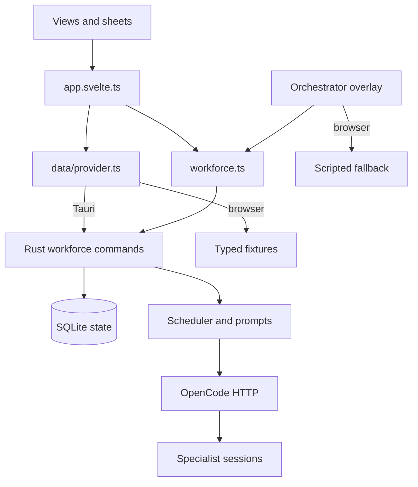

# Architecture

Agent Bots is a local-first desktop control plane. The Svelte renderer owns presentation. The Rust core owns the workforce snapshot, task scheduling, policy gate, and the bridge to OpenCode. OpenCode owns model calls, tools, sessions, and permissions.

## Runtime

- Tauri 2 shell with three windows: main 1360x820 (1080x720 floor), a 920x680 resizable frameless orchestrator overlay (640x480 floor) opened with `Alt+\``, and a 480x150 always-on-top habitat strip.
- Svelte 5 renderer with runes, TypeScript strict, Vite 8, Tailwind CSS 4.
- SQLite database at `app_data_dir/workforce.db`. One `state` row stores the full snapshot as JSON. This is deliberate for the first draft; normalized tables come later.
- The app attaches to the existing OpenCode background service instead of spawning a private `serve` child. It discovers the URL with `opencode service status` and reads the local IPC password from `~/.config/opencode/service.json`. The service stays alive when the app exits.
- CSP allows local assets, inline styles, and Tauri IPC only. No remote page is loaded.

## Layers

Views receive a `Snapshot` prop. They never import fixtures directly. `src/lib/data/provider.ts` is the only read seam. `src/lib/workforce.ts` is the only write client.

## State flow

1. `init()` calls `loadSnapshot()`.
2. In Tauri, `workforce_snapshot()` returns the SQLite snapshot. If empty, the renderer clones fixtures, calls `workforce_seed()`, and uses the stored result. Seeding normalizes fake running/review tasks to queued, disables seed auto-start, starts agents idle, and clears scripted chat, seed activity, and sample proposals/runs. A pre-runtime database without `schemaVersion: 3` is migrated on read; plan-created task ids are preserved, and v2 chat is kept while stale seed session ids are cleared.
3. Every mutating command returns the authoritative snapshot. `runWorkforceAction()` replaces `app.snapshot`; the current view and sheet stay open.
4. The Rust core subscribes to OpenCode `/api/event` and emits `workforce-event` for session, message, and permission changes. Each app window debounces that event into `workforce_tick()` then `workforce_poll()`. A 15-second fallback sync covers the volatile/disconnected SSE stream; the per-page guard, run lock, and task claim prevent duplicate work.
5. The overlay refreshes the snapshot on focus and after chat or plan actions.

## Workforce commands

| Command | Purpose |
|---|---|
| `workforce_snapshot` | Read the stored snapshot or null |
| `workforce_seed` | Store the fixture snapshot once |
| `workforce_inspect_project` | Check a folder for existence, policy, README, and Git |
| `workforce_create_project` | Add or import a project; optionally create folder, starter policy/README, and Git repo |
| `workforce_create_task` | Create a manual queued task with owner, priority, acceptance, and optional auto-start |
| `workforce_plan` | Ask the orchestrator for a task plan, create tasks, append activity and chat |
| `workforce_send` | Send an orchestrator chat prompt and store the reply |
| `workforce_tick` | Start ready `autoStart` tasks |
| `workforce_poll` | Finish running sessions into review or blocked |
| `workforce_run_task` | Run or retry one task |
| `workforce_accept_task` | Accept a review result and mark it done |
| `workforce_abort_task` | Interrupt a session and block the task |
| `workforce_dreamer` | Run Dreamer and store pending memory proposals |
| `workforce_decide_proposal` | Approve or reject a pending proposal |

## Project onboarding

Project setup is an app action, not an orchestrator action. The app owns the project list and filesystem boundary.

The **New project** sheet supports all three starting cases:

| Case | Flow |
|---|---|
| Folder exists, no project yet | Enter name/key/path. Leave folder creation off. The app checks the folder and can add a missing `AGENTS.md`. |
| Mid-project | Import the same way. The folder's `AGENTS.md`, README, and current files remain the source of truth for agents. |
| Idea only | Enter a new `D:\Projects\<name>` path, enable folder creation, and optionally create a starter `AGENTS.md`, `README.md`, and Git repository. |

The backend validates:

- absolute folder path
- unique project key and unique folder path
- path is a directory
- folder exists or create-folder is enabled
- starter files are only created when missing
- `git init` runs only when requested and no `.git` exists

The form never overwrites an existing `AGENTS.md` or `README.md`.

## One orchestrator, project scopes

There is one orchestrator role, not one orchestrator per folder. Projects are scopes. The orchestrator's chat/session is project-scoped, and its context comes from the selected project record and that project's files.

The orchestrator knows:

- the app snapshot: projects, tasks, agents, memory, activity
- the selected project's `repoPath`, context, instructions, and `AGENTS.md`
- project files it can read with OpenCode tools
- recent project chat

It does not know arbitrary folders on the PC. Generated agent permissions deny external directories, `.env` reads, and subagents. This is deliberate: the app controls filesystem access, the orchestrator controls planning inside the selected scope. Dreamer memory is scoped global/project/agent, not omniscient.

## OpenCode integration

The app does not implement a second model/tool loop. It attaches to the shared OpenCode service and uses the HTTP API for sessions, prompts, messages, permissions, and MCP status.

- Chat uses one session per project with `orchestrator-workforce`.
- Plan uses a one-shot `orchestrator-workforce` session and expects a JSON object. The first JSON object is extracted from the reply.
- Task sessions use the owner's OpenCode agent: `pixel`, `forge`, `scout`, `voice`, `probe`, `iris`, `verity`.
- Dreamer uses `dreamer`.
- A session becomes review when `time.idle >= startedAt` or an outcome is set. A missing session or a run longer than 30 minutes becomes blocked.
- Permissions: generated agent files allow workspace tools but deny questions, secrets, external directories, subagents, and obvious destructive commands. Task sessions do not add broader session permissions.
- Model selection: `AGENT_BOTS_MODEL` as `provider/model`, otherwise `opencode-go/deepseek-v4.1-flash`.
- The global `AGENTS.md` and project `AGENTS.md` must both exist before a real run. The task prompt includes both policies, the role prompt, approved project memory, the DevVault root/Home/hub paths with the global maintenance rule, acceptance criteria, and the handoff contract.
- Generated agents deny external directories except the DevVault root (`DEVVAULT_PATH`, default `%USERPROFILE%\Obsidian\DevVault`), so task agents can maintain their hub note and Home row as the global policy requires.
- Settings > OpenCode runtime has a 30-second service timeout and a 35-second agent/MCP timeout. While connecting it shows Cancel. A stale child left by a previous crash may require restarting the app.

## Skills and MCP

The app does not reimplement skills or MCP. The OpenCode child process loads the same global and project configuration as the normal OpenCode session.

- At the `CORE` project location, OpenCode reports `ponytail`, `caveman`, `impeccable`, and the HyperFrames skills as registered. Ponytail is also installed as a global plugin.
- The generated agents allow `skill` actions by default; no agent denies them.
- Every task prompt includes the global `AGENTS.md`, so the Caveman/Ponytail working style is binding even when a skill is not explicitly loaded.
- MCP servers at the same location report connected: `jev`, `laya`, `n8n-mcp`, `playwright`, `rea`, `stitch`.
- MCP tool actions use `allow` rules in generated agents, so OpenCode runs them without a prompt. Interactive chat, Plan, and Dreamer still auto-reply `once` to any other pending permission (up to 16 per turn); the orchestrator permission set still denies shell, edit, subagent, external-directory, and `.env` access. Task detail keeps the permission panel as a fallback for unexpected requests. The `browser` deny is for OpenCode's built-in browser action, separate from `<server>_<tool>` MCP actions.
- Limitation: the scheduler does not preflight MCP health before starting a task. Check Settings > OpenCode runtime for current status. External MCP actions remain a trust boundary, and shell actions are still broader than MCP actions.

## Agent sync

`scripts/sync-agents.mjs` reads the source prompts in `prompts/agents/` and writes nine primary OpenCode agents to both the repo's `.opencode/agents/` and the global `%USERPROFILE%\.config\opencode\agent/`. Global installation makes the agents available in every project selected in the app:

| App agent | OpenCode agent |
|---|---|
| Orchestrator | `orchestrator-workforce` |
| Dreamer | `dreamer` |
| Pixel | `pixel` |
| Forge | `forge` |
| Scout | `scout` |
| Voice | `voice` |
| Probe | `probe` |
| Iris | `iris` |
| Verity | `verity` |

Run `npm run sync:agents` after changing a role prompt. `npm run check:agents` validates the generated files. The source prompt remains the single editable source.

## Scheduler rules

- Maximum two running tasks.
- One running task per owner.
- Only `autoStart` tasks are started by the tick. Manual tasks use Run or Retry.
- Dependencies must all be `done`.
- A task is claimed in SQLite before the OpenCode session is created, so two ticks cannot start the same task.
- The next dependent task starts after the previous task is accepted.
- Git projects run each task in an isolated worktree under the app data directory, branch `agent-bots/<task-id>`. The base repo must be clean; otherwise the task blocks instead of missing uncommitted work. Accept commits the worktree, fast-forwards the base branch, and removes the worktree/branch. Dirty or conflicting bases leave the task in review with an error. Non-git projects run in place.

## Orchestrator UX

The overlay has two modes:

- **Chat**: real `workforce_send` in Tauri; scripted replies only in the browser preview. Assistant replies render through `Markdown.svelte`, a safe subset parser that never injects raw HTML.
- **Plan & run**: real `workforce_plan`; creates queued tasks and returns a summary. The scheduler starts ready tasks automatically.

Reference chips open the linked task, agent, or project in the main window. The overlay does not expose model or API configuration.

## Memory

Dreamer reads project context, review/done task results, and existing memory. It returns JSON findings and proposals. Proposals are stored as pending. Approving applies `add`, `update`, `delete`, or `merge` to canonical memory; rejecting records the decision only. Task prompts include the latest eight approved entries for that project.

## Security posture

- No secret is stored in the repository or fixture set.
- The app never asks for provider keys and never reads provider configuration. It reads only the local OpenCode `service.json` IPC password for loopback API auth; that value never reaches the renderer.
- Model calls happen only when the user sends, plans, runs a task, or starts Dreamer.
- Shell permissions remain broad for task execution. Generated agents deny any command containing `Remove-Item`, plus `Remove-Item *`, `del *`, `rmdir *`, `rm -rf *`, destructive Git commands, `format`, shutdown, and restart. This is pattern matching, not a sandbox; a command outside the list can still run. Tighten the shell allowlist before using an untrusted project.
- Agents cannot launch subagents.
- `.env` files and external directories are denied by generated agent permissions.
- The policy gate stops a run when the global or project `AGENTS.md` is missing.
- MCP tools are auto-allowed by generated agents. This is a deliberate speed tradeoff: any MCP tool exposed to the agent can run without a prompt. Keep MCP servers scoped and review their tool catalogs. Chat, Plan, and Dreamer auto-approve any remaining pending request once, up to 16 per turn. Task detail retains the explicit Allow once, Always, or Deny fallback for non-MCP requests.

## Current limits

- SSE is live-only and volatile; the bridge reconnects and a 15-second polling fallback recovers missed events. There is no replay or Last-Event-ID recovery.
- Worktrees require a clean Git repo and a fast-forwardable base branch; merge conflicts remain manual.
- Manual tasks are created from Tasks → New task; there is no task editing form.
- One chat session per project; if OpenCode restarts, the next chat recreates it.
- The habitat is display-only: status dots and names, no pet interaction yet.
- The packaged installer is NSIS; bundled agents are installed into the global OpenCode agent directory on startup.
- Manual live runtime smoke passed; no full Plan/task/Dreamer evaluation has been run.
- No visual regression or DOM test harness.

Related: [[Home]] · [[Data-Model]] · [[Testing]] · [[Agent-Prompts]] · [[First-Draft]]
