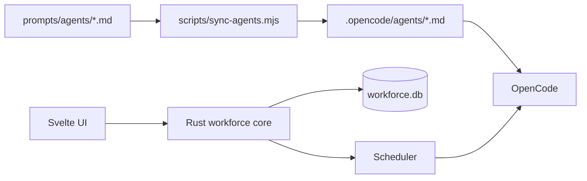

# Bot-Workspace

The repository began as a headless OpenCode multi-agent workspace. That workspace still exists, but it is legacy. The desktop app now owns its own SQLite store, task lifecycle, scheduler, and generated agents.

## Legacy workspace

| Item | Status |
|---|---|
| `.opencode/agents/orchestrator.md` | Legacy primary agent using `tools/taskboard.py` |
| `browser-bot`, `research-bot`, `code-bot`, `writer-bot` | Legacy subagents |
| `tools/taskboard.py` | Legacy stdlib SQLite CLI |
| `taskboard.db` | Legacy local task board |
| `.opencode/opencode.json` | Legacy project config with Playwright MCP |

Nothing in the desktop app reads `taskboard.db` or calls the legacy taskboard commands.

## App workforce

The app generates its own primary agents from `prompts/agents/`:

```text
.opencode/agents/
  orchestrator-workforce.md
  dreamer.md
  pixel.md
  forge.md
  scout.md
  voice.md
  probe.md
  iris.md
  verity.md
```

`npm run sync:agents` writes them. `npm run check:agents` validates them. Roles stay in `prompts/agents/`; generated files are not the source of truth.



## Mapping

| Legacy | App |
|---|---|
| `todo` | `queued` |
| `running` | `running` |
| `done` | `done` |
| `blocked` | `blocked` |
| no equivalent | `review` |
| flat owner string | `Task.ownerId` plus `Agent.id` |
| `messages` rows | `Task.messages` plus `chat` |

The app also persists projects, memory, proposals, Dreamer runs, activity, providers, artifacts, and chat. The legacy board only had tasks and messages.

## What to keep

- Keep `.opencode/agents/` generated and checked.
- Keep the legacy files only as reference until someone explicitly deletes them.
- Do not wire `taskboard.py` back into the app.
- Do not edit generated agent files by hand; edit `prompts/agents/` and rerun the sync.

Related: [[Architecture]] · [[Agent-Prompts]] · [[Data-Model]]
