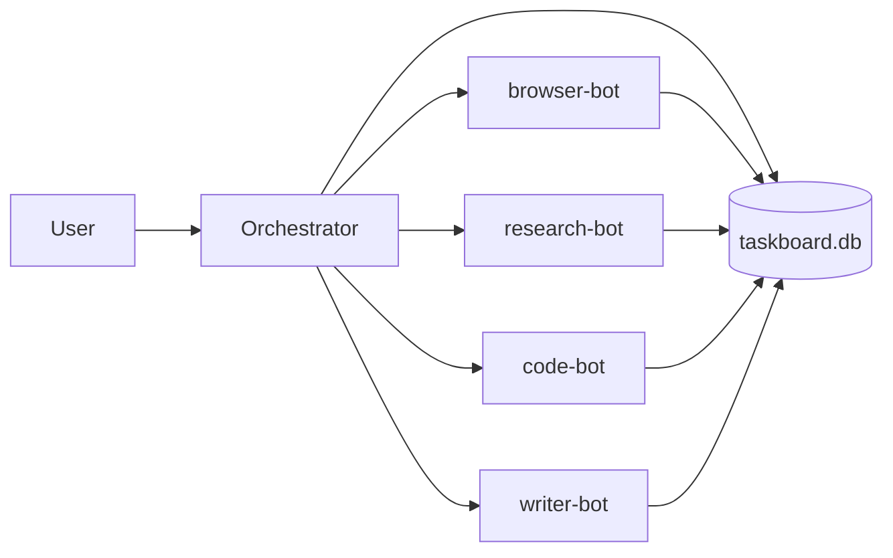

# Bot-Workspace

The repository began as a headless OpenCode multi-agent workspace. It still exists and is the most plausible first backend for the desktop app.

## Agents

| Agent | Mode | Responsibility |
| --- | --- | --- |
| `orchestrator` | primary | Receives requests, splits work, delegates, reports |
| `browser-bot` | subagent | Playwright browsing and form actions |
| `research-bot` | subagent | Web research and summaries |
| `code-bot` | subagent | Focused code changes and tests |
| `writer-bot` | subagent | Documents and reports |

Definitions live in `.opencode/agents/`. The orchestrator has explicit subagent permissions and shell, read, edit, write, webfetch, and websearch access.

## Task board

`tools/taskboard.py` is a stdlib-only SQLite CLI at `taskboard.db`.

```text
tasks(id, title, owner, status, notes, created_at, updated_at)
messages(id, task_id, sender, text, created_at)
```

Commands: `add`, `claim`, `update`, `message`, `list`. The database uses WAL and a 30-second busy timeout. Bots never address the user; they claim tasks and append messages. The orchestrator polls and reports.

## Flow



## Mapping to the app

The desktop interface is not wired to this board. When it is, an adapter must translate:

| taskboard.db | App |
| --- | --- |
| `todo` | `queued` |
| `running` | `running` |
| `done` | `done` |
| `blocked` | `blocked` |
| (no equivalent) | `review` |
| `messages` rows | `Task.messages` |
| flat `owner` string | `Task.ownerId` plus agent lookup |

The app also expects projects, memory, providers, artifacts, and a chat transcript, none of which exist in `taskboard.db`. The backend layer must either add tables for them or aggregate them from other sources.

## Current status

The workspace is not running as part of the desktop app. Nothing in the UI reads `taskboard.db`, launches an OpenCode session, or calls a model.

Related: [[Architecture]] · [[Data-Model]]
