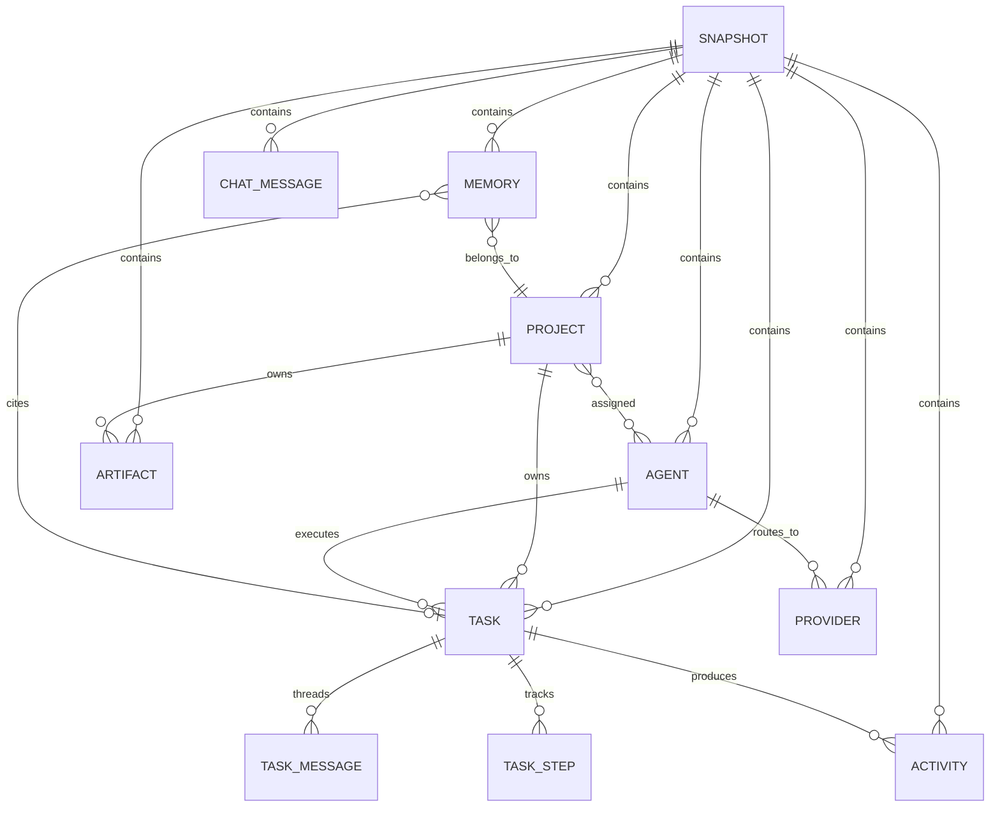

# Data-Model

`Snapshot` contains the mock workforce only. OpenCode sessions, messages, permissions, and runtime status live outside the snapshot in the Rust runtime adapter and are not persisted by the app yet.

## Shape

## Entities

| Entity | Identity | Key fields | Notes |
| --- | --- | --- | --- |
| `Agent` | slug (`forge`) | role, status, providerId, modelId, promptId, capabilities, instructions, currentTaskId | `promptId` must match a prompt frontmatter id; one `currentTaskId` at most, and it must be a running task owned by the agent |
| `Project` | slug (`vault`) | key (`VLT`), status, context, instructions, repoPath | Key is the human label in tables and chat references |
| `Task` | `t-###` | status, priority, projectId, ownerId, steps, messages, notes | Narrative unit; carries its own thread |
| `TaskMessage` | `m-####` | senderId, text, at | Sender may be any agent including the orchestrator |
| `TaskStep` | label within task | label, done | Progress bar is derived, not stored |
| `ActivityEvent` | `ev-##` | kind, actorId, projectId, taskId, summary | Flat feed; no parent event |
| `MemoryEntry` | `mem-##` | kind, projectId, content, source, confidence, linkedTaskId | Confidence 0 to 1; source names a task or file |
| `Provider` | slug (`local`) | kind, endpoint, configured, models | Unconfigured providers may still be listed |
| `Model` | slug | name, context, note | Context stored as tokens |
| `Artifact` | `art-##` | projectId, name, kind, path | File, doc, or URL |
| `ChatMessage` | `chat-##` | role, text, at, refs | Refs are typed links into the snapshot |

## Invariants

Enforced by `tests/data.test.ts`:

1. Every task owner and project exists.
2. Every activity actor, project, and task exists when set.
3. Every memory project and linked task exists; confidence stays in 0 to 1.
4. Identifiers are unique within each collection.
5. An agent's current task is running and owned by that agent.
6. Every agent model resolves to a configured provider.
7. Metrics equal the underlying task status counts.
8. Project progress and task step progress stay in 0 to 1.
9. Activity and memory filters return strict subsets.
10. Chat reference chips point at real tasks, agents, or projects.
11. Every agent `promptId` matches a prompt frontmatter id.
12. Proposals and Dreamer runs reference real projects, agents, memory entries, and proposals; evidence is present and confidence is bounded.

## Fixtures

| File | Contents |
| --- | --- |
| `Clock` | `clock.ts` | `NOW` plus minute, hour, day offsets captured at module load |
| `agents.ts` | 9 agents: orchestrator, dreamer, forge, pixel, scout, voice, probe, iris, verity |
| `projects.ts` | 4 projects: Agent Bots, Vault API, Field Notes, Launch Page |
| `tasks.ts` | 30 tasks across all statuses and four projects |
| `activity.ts` | 38 events, newest first, spanning roughly four days |
| `memory.ts` | 16 entries across decisions, references, docs, results, conventions |
| `proposals.ts` | 5 memory proposals: pending, approved, rejected |
| `dreamer-runs.ts` | 4 Dreamer runs: milestone, manual, reflection |
| `providers.ts` | 4 providers and 7 models; OpenRouter deliberately unconfigured |
| `artifacts.ts` | 9 artifacts tied to projects |
| `chat.ts` | 6-message opening thread with task and agent references |

Status distribution: 3 running, 5 in review, 1 blocked, 13 queued, 8 done.

## Time

All timestamps are epoch milliseconds, anchored to `Date.now()` when the fixture module loads. Relative display uses `timeAgo`, `clockTime`, `fullTimestamp`, and `dayLabel` in `src/lib/format.ts`. The dataset is intentionally static: no timers advance state.

## Adding data

1. Add the record to the relevant fixture file with a new unique id.
2. Point at existing agents, projects, and tasks; do not invent ids.
3. Run `npm test` and `npm run check`.
4. If the record should appear in the opening chat, add a `ChatRef` with a matching kind and id.
5. Update the counts here if the scale changes.

## Backend replacement

`Snapshot` is JSON-serializable by design: no `Date`, `Map`, or class instances. A Rust command can return the same shape with `serde`, or an HTTP client can parse it. Keep field names and epoch milliseconds stable to avoid touching the UI.

Related: [[Architecture]] · [[Testing]] · [[Bot-Workspace]]
