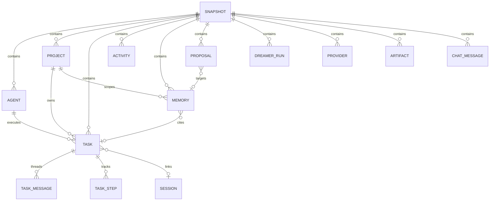

# Data-Model

The workforce snapshot is the contract between the Svelte renderer and the Rust core. It is stored as one JSON document in SQLite for the first draft, seeded once from the local fixtures, and returned by every command. The document carries a top-level `schemaVersion`; missing or older versions are migrated on read.

## Persistence

```text
app_data_dir/
  workforce.db
    state(id = 1, json, updated_at)
```

- `workforce_snapshot()` reads the row.
- `workforce_seed(snapshot)` writes it only when empty.
- Every mutating command reads, changes, and writes the full document under a connection mutex.
- Browser-only development uses `src/lib/data/index.ts` and does not write SQLite.

A normalized schema is future work. The JSON document is intentional for the first draft: one contract, one migration surface, no duplicated permit/deny logic.

## Shape



## Entities

| Entity | Identity | Key fields | Notes |
|---|---|---|---|
| `Agent` | slug (`pixel`) | `opencodeAgentId`, role, status, providerId, modelId, promptId, currentTaskId | `opencodeAgentId` is the real OpenCode agent. Defaults to `id`. |
| `Project` | slug (`core`) | key, status, context, instructions, repoPath | A real run requires the repo and both policy files. |
| `Task` | `t-*` | status, priority, ownerId, projectId, steps, messages | See optional fields below. |
| `Task` optional | | `acceptance`, `dependsOn`, `sessionId`, `result`, `autoStart`, `startedAt`, `finishedAt`, `permission`, `worktreePath`, `worktreeBranch` | Written by Plan, Run, Poll, and Accept, or by `workforce_create_task` for a manual task. Worktree fields are cleared after a successful merge. |
| `TaskMessage` | `m-*` or generated | senderId, text, at | Sender is an app agent id. |
| `ActivityEvent` | `ev-*` | kind, actorId, projectId, taskId, summary, detail | Newest first; IDs are unique per millisecond. |
| `MemoryEntry` | `mem-*` | kind, projectId, content, source, confidence, linkedTaskId | Approved canonical memory. |
| `MemoryProposal` | `prop-*` | action, scope, kind, title, content, evidence, confidence, status | Pending until approved or rejected. |
| `DreamerRun` | `run-*` | trigger, projectId, findings, proposalIds, status | One run per Dreamer action. |
| `Provider` | slug | kind, endpoint, configured, models | Display metadata; the app does not read credentials. |
| `Artifact` | `art-*` | projectId, name, kind, path | Still display-only. |
| `ChatMessage` | `chat-*` | role, text, at, refs | Persisted orchestrator thread. |

## Project onboarding

`workforce_create_project` adds a `Project` record with:

| Field | Rule |
|---|---|
| `id` | Lowercase project key; must be unique |
| `key` | 2 to 8 uppercase letters/digits; unique |
| `name` | Required, 80 characters maximum |
| `repoPath` | Absolute folder path; unique |
| `description`, `context`, `instructions` | User-supplied planning context |
| `status` | `active` |

Optional filesystem actions:

- create the folder when missing
- create a starter `AGENTS.md` only when missing
- create a starter `README.md` only when missing
- run `git init` only when requested and no `.git` exists

A project is added to every app agent's `projectIds` so it appears in project views. The project is not runnable until its folder and `AGENTS.md` exist.

## Task lifecycle

```text
queued -> running -> review -> done
   |         |          |
   |         +-> blocked <-+
   +-> blocked (retry allowed)
```

- **queued**: ready or waiting for dependencies.
- **running**: claimed in SQLite and linked to an OpenCode session.
- **review**: the session went idle; result text is stored.
- **done**: the user accepted the result.
- **blocked**: start, session, policy, or timeout failure. Retry is allowed from task detail.

`autoStart` is true only for Plan-created tasks. The scheduler ignores fixture tasks until the user clicks Run.

## Invariants

Enforced by `tests/data.test.ts` and `src-tauri/src/workforce.rs` tests:

1. Every task owner and project exists.
2. Every activity actor, project, and task exists when set.
3. Every memory project and linked task exists; confidence stays in 0 to 1.
4. Identifiers are unique within each collection.
5. An agent's current task is running and owned by that agent.
6. Every agent model resolves to a configured provider.
7. Metrics equal the underlying task status counts.
8. Project and step progress stay in 0 to 1.
9. Activity and memory filters return strict subsets.
10. Chat reference chips point at real entities.
11. Every agent `promptId` matches a prompt file.
12. Proposals and runs reference real records and carry evidence.
13. Task dependencies exist and never point at the task itself.
14. Every app agent has a unique OpenCode agent id.
15. A JSON object can be extracted from a model reply without treating prose braces as JSON.
16. Dependency readiness requires every dependency to be done.
17. The store seeds once and persists updates.

## Seed behavior

The Rust store starts empty. The renderer seeds it from the fixture snapshot on first launch. This preserves a coherent demo workspace without duplicating 30 tasks in Rust.

- Fixtures remain in `src/lib/data/`.
- Browser-only preview uses fixtures directly.
- Desktop first launch writes a normalized copy to SQLite: all seed tasks get `autoStart: false`, fixture `running` and `review` tasks become `queued`, fake session ids and results are cleared, active agents start idle, and the scripted chat, seed activity, and sample proposals/runs are cleared. This prevents the UI or scheduler from starting a model session before the user asks.
- Later changes are stored in SQLite and survive restart.

### Pre-runtime migration

An existing database without the current `schemaVersion: 3` is migrated on first read:

- only seed-shaped task ids (`t-101`, `t-102`, ...) are normalized; Plan ids (`t-<epochms>-<index>`) are left intact
- seed `autoStart` is disabled
- seed running/review tasks become queued with fake session ids/results cleared
- stale seed current-task pointers are cleared
- schema v2 adds a second pass that clears old blocked seed session ids while keeping real chat
- schema v1 also removes scripted chat, seed activity, and sample proposals/runs
- `schemaVersion` becomes 3

## Time

All timestamps are epoch milliseconds. `startedAt` is set after the task prompt is accepted, so a session's older idle timestamp cannot complete a task prematurely. The 30-minute timeout is measured from `startedAt`.

Related: [[Architecture]] · [[Testing]] · [[First-Draft]]
