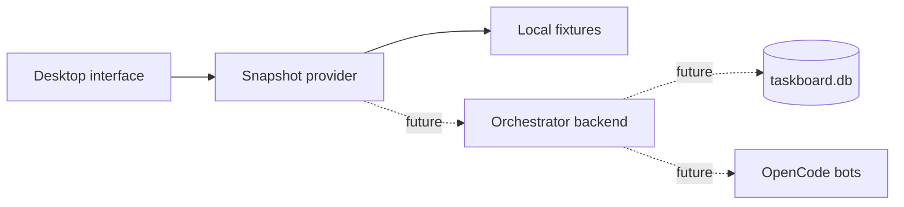

# Home

Agent Bots is a local-first desktop control center for a personal AI workforce. One orchestrator is the interface; specialist agents do the work; Dreamer keeps durable memory. This repository holds two layers:

1. **Desktop application** (implemented): the Tauri 2 and Svelte 5 interface, currently running on a realistic mock snapshot.
2. **Bot workspace** (existing): the OpenCode agent definitions and SQLite task board that can become the first real orchestrator backend.

## Current state

The app is an interface preview for workforce data. It has no backend for agents, tasks, projects, or memory, and no live agent cards. The OpenCode runtime panel in Settings is live: it can start a real local OpenCode session, stream its messages by polling, and reply to permission requests. The orchestrator overlay remains scripted.

## Run

```sh
npm install
npm run tauri dev      # desktop window
npm run dev            # renderer only, http://localhost:1420
```

Verification:

```sh
npm run check          # svelte-check, zero diagnostics
npm test               # 10 dataset and selector invariants
npm run build          # production renderer bundle
```

## Docs

- [[Architecture]] — desktop layers, provider seam, security, integration path.
- [[Agent-Prompts]] — role prompts, routing, boundaries, policy precedence.
- [[Design-System]] — matte dark identity, tokens, component and motion rules.
- [[Data-Model]] — entities, relationships, invariants, fixture layout.
- [[Testing]] — commands, what is covered, manual verification.
- [[Bot-Workspace]] — OpenCode agents, task board, and future mapping.

## Map


