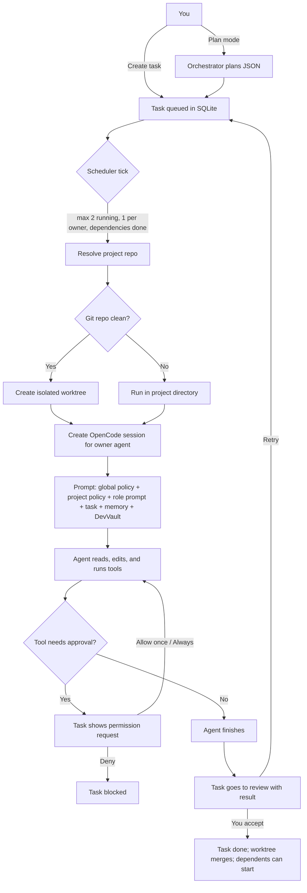
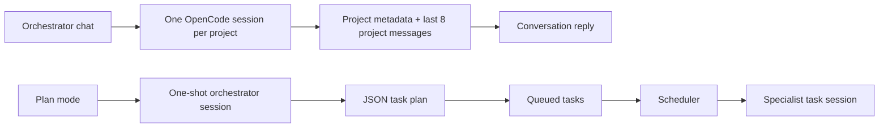
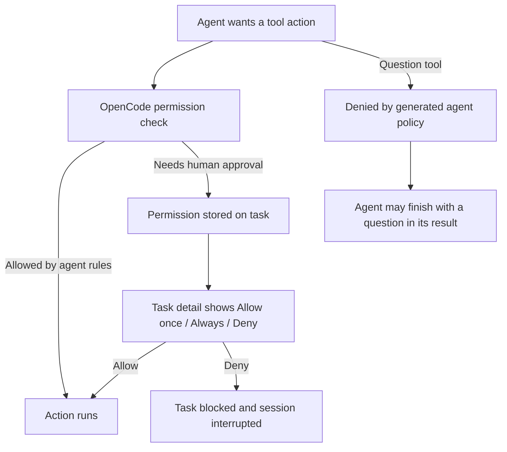
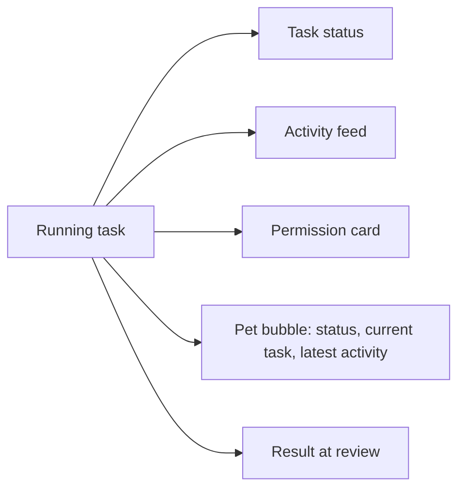

# Workflow

This page explains what happens after you chat with the orchestrator, create a task, or run Plan, what you must approve, and where progress and questions appear.

## Task lifecycle



The scheduler starts at most two tasks at once. It never starts two tasks for the same owner. A task with unfinished `dependsOn` entries stays queued.

## Chat vs Plan vs Task



Important differences:

- Chat is conversation. It does **not** start a task and does not automatically inspect the task board. Use Plan to create work.
- Plan creates queued tasks with `autoStart: true`. The scheduler starts ready tasks; it does not run the whole plan synchronously.
- A task is executed by one specialist agent, not by the orchestrator itself.
- The task agent gets the full policy stack, task description, acceptance criteria, approved project memory, and DevVault context.
- Chat now gets project metadata, the project task board with statuses, approved project memory, and recent project chat. It still cannot create, accept, run, or retry tasks from chat; use Plan or Tasks.

## Permissions and questions



Current behavior:

- Task permission requests are auto-approved up to 16 per task; the event is recorded in Activity.
- Hard agent-policy denials still apply: destructive shell patterns, `.env`, external directories, subagents, and the question tool.
- There is no separate live question inbox. Generated agents deny the OpenCode `question` tool; an agent cannot pop a live dialog. It requests a permission, stops blocked, or returns a result explaining what it needs.
- Orchestrator questions are ordinary chat replies. Open the orchestrator to read them.
- Native notifications are reserved for final project complete/stopped events; the Alerts bell shows task attention states.

## Review actions

In autonomous mode a completed result is auto-accepted, merged when a worktree exists, and scheduled forward. Manual review controls remain as a fallback when automatic acceptance fails or when the operator intervenes:

- **Accept result** — mark done, merge an isolated Git worktree when present, and unblock dependents.
- **Reject result** — requires a short reason; the task becomes blocked with that reason in its notes.
- **Edit task** — change title, description, acceptance, priority, or owner. Editing a review task moves it back to blocked so the old result cannot be mistaken for the new scope.
- **Retry** — start a blocked task again after editing or after fixing the cause.

## Where progress appears



The task states are:

```text
queued -> running -> review -> done
                    |
                    +-> blocked
```

What is live:

- **Alerts bell**: badge for permission requests, review results, and blocked tasks; click an item to open the task.
- **Tasks**: queued/running/review/blocked/done status, session id, result, permission card, and a review banner with a Review next shortcut.
- **Activity**: start, finish, permission, accept, delegation, and memory events.
- **Overview**: active work and recent activity.
- **Pet pen**: all nine agents confined in one draggable/resizable enclosure; the in-pen bubble shows status, current task, and latest activity.

What is not live:

- No token-by-token stream in the app.
- No reliable percentage progress. `steps` are usually empty, so the progress bar stays at 0 until a result exists.
- The orchestrator does not push progress reports. It can now read the task board and reports when you message it.
- The app polls the session and updates status; the task result appears at review.

## Project chat consistency

Chat is now project-scoped:

- The backend keeps one OpenCode chat session per project and filters the last eight prompt messages by project references.
- User messages are tagged with the selected project.
- The visible thread is filtered by the selected project.
- Switching the project selector switches both the visible thread and the backend session.
- The session map is in memory; after an app restart, the next chat creates a new OpenCode session, but stored project chat is still used as context.

## Models

All app-started sessions currently use one model setting:

```text
opencode-go/deepseek-v4.1-flash
```

That includes orchestrator chat, Plan, specialist tasks, and Dreamer. The generated agent files also contain a `model` field, but the app passes its explicit model when creating a session.

Change the model for the app:

```powershell
$env:AGENT_BOTS_MODEL = "provider/model"
npm run tauri dev
```

Persistent Windows setting:

```powershell
setx AGENT_BOTS_MODEL "provider/model"
```

Then restart the app. The provider/model must exist in OpenCode and have working credentials.

To change the model written into generated agent files for direct OpenCode use:

```powershell
$env:AGENT_BOTS_AGENT_MODEL = "provider/model"
npm run sync:agents
npm run check:agents
```

There is currently no per-role model selector in the app. Frontend, backend, research, testing, and the orchestrator all use the same `AGENT_BOTS_MODEL` override.

## Memory automation

Dreamer runs on demand, not concurrently with specialist tasks. It reads the selected project's task results, project markdown, DevVault hub, and memory evidence.

When a Dreamer run finishes:

- `add` and `update` proposals at **80% confidence or higher** are approved and applied automatically
- proposals below 80% are rejected automatically
- `delete` and `merge` proposals are automatically rejected; destructive memory changes are never auto-applied and never block the loop
- the run and the auto-decision counts appear in Activity
- pending proposals from earlier runs are auto-reviewed the same way on app start and on the next Dreamer run

Change the cutoff:

```powershell
$env:AGENT_BOTS_MEMORY_THRESHOLD = "0.9"
```

The default is `0.8`. Automatic acceptance does not bypass project scoping or evidence requirements.

## Code quality gate

Every task prompt now requires the agent to:

- inspect the existing project structure before editing
- preserve established conventions
- use real components or modules instead of a monolithic source dump
- add a focused test for non-trivial logic
- run the project's typecheck, lint, tests, and build
- report changed files and exact checks

Plan prompts also require an explicit structure, runnable checks, and a final independent quality/audit gate for implementation work. The Auditing role now covers file structure, duplication, dead code, testability, and convention drift in addition to security.

## Multi-phase autonomous projects

A project created with **Run autonomously after each phase** enabled stores its mission in its description, context, and instructions. When all tasks in the current phase are done:

1. Dreamer consolidates the finished phase into memory.
2. The orchestrator receives the mission, task board, approved memory, and completed results.
3. It plans only the remaining work.
4. The scheduler starts the queued tasks.
5. The cycle repeats until the planner returns an empty task array or the phase limit is reached.

The default phase limit is **6** and can be set from 1 to 20 when creating the project. An empty plan marks the project complete. A blocked task stops the project and sends the final stopped notification. Project autonomy is opt-in per project; older projects without the flag stay paused.

## Always-on operation

The app registers itself for Windows login autostart through the Tauri autostart plugin. The **Settings → Startup** toggle can disable or re-enable it. While the process is running it:

1. starts queued tasks automatically
2. auto-approves tool permission requests within the agent policy
3. accepts completed results and merges worktrees
4. starts the next ready dependency
5. sends a final project-complete or project-stopped notification

Closing the main window still exits the app; on the next login it starts again. A crash or manual exit stops the loop until the app is started.

## End-to-end expectation

A realistic test run looks like this:

1. Create or import a project.
2. Create a task manually or use Plan.
3. Watch the task move from `queued` to `running`.
4. If a permission card appears, decide.
5. Wait for `review`.
6. Read the result and accept it.
7. For a Git project, accepting merges the isolated worktree. For a non-Git project such as the Live Test folder, work happens directly in the project directory.
8. Run Dreamer if you want durable memory proposals.

A task does not silently become done. It waits in review. A task can also stop blocked because of a denied permission, missing policy, provider failure, missing session, or the 30-minute run limit.

## Current limits

- No live agent question dialog. Review results and permission cards remain the approval surfaces; Alerts and native notifications surface them.
- No token streaming or precise step progress.
- One model for all roles. Agent tool permissions already auto-allow safe workspace and MCP actions; destructive, external, secret, and question operations remain denied.
- Autonomous mode auto-accepts results; manual review remains a fallback and is not required for normal operation.
- A blocked task stops its project; the final notification reports the stopped project. There is no automatic infinite retry.
- Dreamer is on demand, not a continuously running background agent.
- Native notifications require the Windows notification permission; if denied, the in-app Alerts bell still works.
- Git tasks require a clean repository and use worktrees; merge conflicts require manual resolution.
- MCP tool actions are auto-allowed; non-MCP approvals use the task permission card.

Related: [[Architecture]] · [[Data-Model]] · [[Agent-Prompts]] · [[Testing]]
