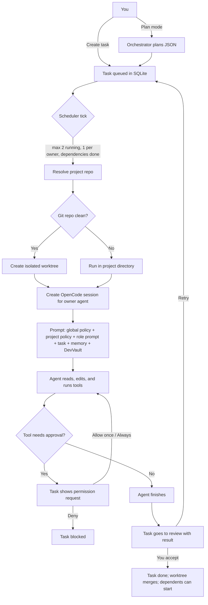
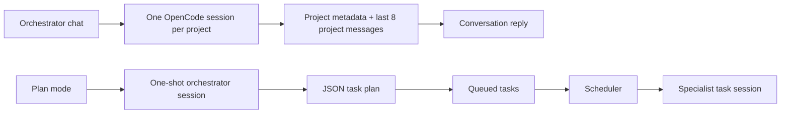
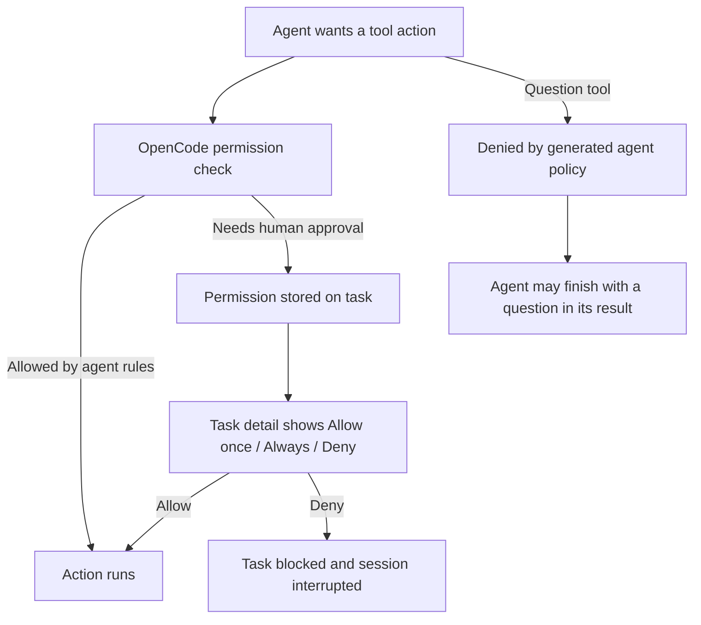
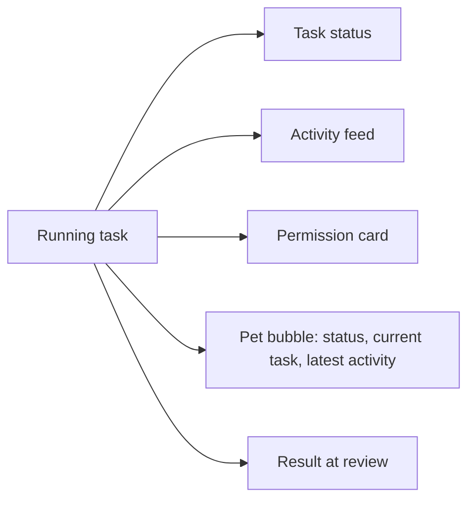

# Workflow

This page explains what happens after you chat with the orchestrator, create a task, or run Plan, what you must approve, and where progress and questions appear.

## Task lifecycle



The scheduler starts at most two tasks at once. It never starts two tasks for the same owner. A task with unfinished `dependsOn` entries stays queued.

## Chat vs Plan vs Task



Important differences:

- Chat is conversation. It does **not** start a task and does not automatically inspect the task board. Use Plan to create work.
- Plan creates queued tasks with `autoStart: true`. The scheduler starts ready tasks; it does not run the whole plan synchronously.
- A task is executed by one specialist agent, not by the orchestrator itself.
- The task agent gets the full policy stack, task description, acceptance criteria, approved project memory, and DevVault context. Chat gets project metadata and recent project chat, not the task board or memory.

## Permissions and questions



Current behavior:

- Permission requests appear on the task in **Tasks**, and as an activity entry. They are the app's real "agent needs you" signal.
- There is no separate questions inbox or desktop notification.
- Generated agents deny the OpenCode `question` tool. An agent cannot pop a live question dialog. It should either request a permission, stop blocked, or return a result explaining what it needs.
- Orchestrator questions are ordinary chat replies. They are visible only when you open the orchestrator.
- If a permission is denied, the task becomes blocked and the session is interrupted.

## Where progress appears



The task states are:

```text
queued -> running -> review -> done
                    |
                    +-> blocked
```

What is live:

- **Overview**: active work, recent activity.
- **Tasks**: queued/running/review/blocked/done status, session id, result, permission card.
- **Activity**: start, finish, permission, accept, delegation, and memory events.
- **Pet bubble**: agent status, current task, latest activity.

What is not live:

- No token-by-token stream in the app.
- No reliable percentage progress. `steps` are usually empty, so the progress bar stays at 0 until a result exists.
- The orchestrator does not push progress reports to you. It reports when you message it, and its chat context does not currently include the whole task board.
- The app polls the session and updates status; the task result appears at review.

## Project chat consistency

The current implementation is **not yet a fully isolated thread per project**:

- The backend keeps one OpenCode chat session per project and filters the last eight prompt messages by project references.
- The one orchestrator window uses a project selector to choose the backend project and session.
- The visible chat list is still the shared snapshot thread. Messages are not filtered by the selected project in the UI.
- User messages are currently stored with empty references, so they can appear in more than one project's prompt history.

For testing, use one project at a time in the orchestrator and confirm the selected project before sending. A true per-project thread requires tagging user messages with a project reference and filtering the visible thread by that reference.

## Models

All app-started sessions currently use one model setting:

```text
opencode-go/deepseek-v4.1-flash
```

That includes orchestrator chat, Plan, specialist tasks, and Dreamer. The generated agent files also contain a `model` field, but the app passes its explicit model when creating a session.

Change the model for the app:

```powershell
$env:AGENT_BOTS_MODEL = "provider/model"
npm run tauri dev
```

Persistent Windows setting:

```powershell
setx AGENT_BOTS_MODEL "provider/model"
```

Then restart the app. The provider/model must exist in OpenCode and have working credentials.

To change the model written into generated agent files for direct OpenCode use:

```powershell
$env:AGENT_BOTS_AGENT_MODEL = "provider/model"
npm run sync:agents
npm run check:agents
```

There is currently no per-role model selector in the app. Frontend, backend, research, testing, and the orchestrator all use the same `AGENT_BOTS_MODEL` override.

## End-to-end expectation

A realistic test run looks like this:

1. Create or import a project.
2. Create a task manually or use Plan.
3. Watch the task move from `queued` to `running`.
4. If a permission card appears, decide.
5. Wait for `review`.
6. Read the result and accept it.
7. For a Git project, accepting merges the isolated worktree. For a non-Git project such as the Live Test folder, work happens directly in the project directory.
8. Run Dreamer if you want durable memory proposals.

A task does not silently become done. It waits in review. A task can also stop blocked because of a denied permission, missing policy, provider failure, missing session, or the 30-minute run limit.

## Current limits

- Chat display is shared across projects; backend sessions are per project.
- No question inbox or notification.
- No token streaming or precise step progress.
- One model for all roles.
- Git tasks require a clean repository and use worktrees; merge conflicts require manual resolution.
- MCP tool actions are auto-allowed; non-MCP approvals use the task permission card.

Related: [[Architecture]] · [[Data-Model]] · [[Agent-Prompts]] · [[Testing]]
